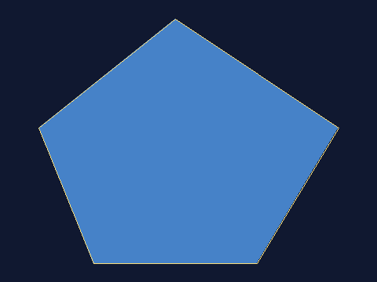

# polygon-scan —— 扫描线多边形填充（作业 1）

> **用途**：用"逐条扫描线求交、排序、成对填充"把多边形填成实心区域，并把过程可视化（逐行动画）。
> **目标读者**：学完像素与变换、想理解"实心图形怎么来的"的读者；以及完成作业 1 的提交者。
> **关联文档**：权威实现 [raster.hpp](../../src/include/gfx/raster.hpp)（画线 + 填充）、[png.hpp](../../src/include/gfx/png.hpp)（自写 PNG）；决策 [adr-0005](../../docs/design/adr-0005-raster-polygon-fill.md)（题目来源：课程发放的《作业 1：多边形扫描转换》，原题文件不随仓库分发）。

> 状态：生效中（2026-09-14）。对应作业 1：多边形扫描转换。

## 一句话

三角形、多边形能"实心"，靠的不是逐个像素猜，而是**按扫描线求出边界交点、排序、成对之间就是内部**。

## 关键概念

- **扫描线（scanline）**：屏幕上一行像素。算法逐行推进，每行只处理与这一行相交的边。
- **边表 ET（Edge Table）**：把所有非水平边按"它的下端 y"分桶；推进到某一行时，属于这一行的边才被取出来。
- **活性边表 AET（Active Edge Table）**：当前扫描线**正在穿过**的那些边。每推进一行：把 ET 中属于新行的边插入 AET，把已经越过上端的边从 AET 移除。
- **交点成对**：一条扫描线与简单多边形的交点个数必为偶数；排序后第 (0,1)、(2,3)… 对之间就是多边形内部。
- **水平边**：与扫描线重合，不产生交点，直接跳过。
- **半开区间规则**（本实现，避免"同一顶点被算两次"）：
  1. 非水平边在 y 方向按 **`[yMin, yMax)`** 参与求交（下端算、上端不算）；
  2. 由此，局部极值点（V 形尖端）处两条边同时进/同时出，交点数为偶数；局部的"峰"处两条边同时退出，不会漏；
  3. 一条扫描线内，交点区间按 **左闭右开 `[xl, xr)`** 取像素，像素 i 覆盖 `[i, i+1)` 并采样其中心 `i+0.5`。

## 算法流程（与权威实现一一对应）

1. **规范化顶点**：剔除零长度边（相邻重合点）、识别"末尾重复写的首点"作为闭合点（`gfx::normalizePolygon`）。
2. **校验**：顶点数 ≥ 3、有向面积非 0（至少三点不共线）、无自交（简单多边形）（`gfx::validatePolygon`）。
3. **自动闭合**：最后一个顶点自动连回第一个（无需用户重复输入首点）。
4. **建边表 ET**：跳过水平边；其余边按 `enterScanline` 分桶（`ScanlineFiller::begin`）。
5. **逐扫描线推进**（`ScanlineFiller::step`）：
   - ① ET 中属于本行的边插入 AET；② AET 中已越过 `yMax` 的边移除；
   - ③ 求各边与本行的交点 x（**直接由边参数计算**：`x = xAtYMin + invSlope·(y+0.5 − yMin)`，不做逐行累加，故无累积误差）；
   - ④ 按 x 升序排序；⑤ 成对取出 ⇒ 本行的填充区间。
6. **写像素**：把各区间的像素写成填充色（`fillCurrentRow`）。
7. **画边界**：填完后再把多边形轮廓画在最上层（`drawPolygonOutline`），保证边界清晰可见。

## 权威实现

| 能力 | 位置 |
|------|------|
| 画线（整数 Bresenham，八个卦限） | `gfx::drawLine` @ [raster.hpp](../../src/include/gfx/raster.hpp) |
| 画多边形轮廓（自动闭合） | `gfx::drawPolygonOutline` |
| 扫描线填充（ET + AET，可逐行推进） | `gfx::ScanlineFiller` / `gfx::fillPolygon` |
| 顶点规范化 / 有向面积 / 校验 | `gfx::normalizePolygon`、`gfx::polygonSignedArea`、`gfx::validatePolygon` |
| PNG 输出（零第三方依赖） | `gfx::savePng` @ [png.hpp](../../src/include/gfx/png.hpp) |

测试：`ctest -R test_raster`（含与"独立射线法实现"的逐像素对照）、`ctest -R test_png`。

> 注：填充与"顶点是顺时针还是逆时针"**无关**（奇偶规则）；作业要求逆时针输入，程序会检测并在终端提示。

## 运行（命令行程序 PolygonFill）

> 更省事：双击 `scripts\run-polygon-fill.cmd`（带菜单：凸/凹/窗口动画/交互输入/非法输入），
> 或 `scripts\build-and-test.cmd` 一键配置+构建+跑全部测试。

```powershell
# 构建（仓库根）
cmake -S . -B build
cmake --build build --target tutorial_polygon_fill

# 文本读入 → 保存 PNG
build\tutorials\PolygonFill.exe --input tutorials\polygon-scan\data\convex-pentagon.txt --output out.png

# 凹多边形：窗口逐条扫描线动画演示
build\tutorials\PolygonFill.exe --input tutorials\polygon-scan\data\concave-arrow.txt --window --animate

# 交互输入（命令行逐个输入顶点）
build\tutorials\PolygonFill.exe --interactive --window

# 完整参数
build\tutorials\PolygonFill.exe --help
```

| 参数 | 说明 |
|------|------|
| `--input <file>` | 从文本文件读顶点 |
| `--interactive` | 从标准输入输入顶点个数与坐标（可与 `--input` 二选一） |
| `--output <file>` | 结果写 PNG（省略且未开窗口时只在终端打印摘要） |
| `--window` | 打开窗口展示结果 |
| `--animate` | 配合 `--window`：逐条扫描线动画演示（高亮当前扫描线，身后留下已填区域） |
| `--size WxH` | 画布尺寸，默认 800x600 |

**退出码**：`0` 成功；`2` 参数错误；`3` 输入文件/格式错误；`4` 多边形非法（顶点不足/共线/自交）；`5` 输出失败。

## 输入文件格式

第一行是顶点个数 `n`，随后 `n` 行每行 `x y`（世界坐标，y 轴向上，建议逆时针）：

```
5
100 80
220 80
280 180
160 260
60 180
```

- 空行与以 `#` 开头的行会被忽略（样例文件带注释）。
- 坐标分隔符支持空格、逗号、括号：`100 80`、`100,80`、`(100, 80)` 均可（交互输入同样支持）。
- **末尾允许重复写一次首点**（闭合点），程序会自动识别，不产生零长度边。
- 世界坐标会被**等比缩放并居中**映射到画布（留 24 px 边距），y 轴翻转（世界向上 → 屏幕向下）。

## 样例数据与预期结果

| 样例 | 类型 | 预期 |
|------|------|------|
| [convex-pentagon.txt](data/convex-pentagon.txt) | 凸（5 顶点，题目示例坐标） | 退出码 0，正常填充 |
| [convex-hexagon-closed.txt](data/convex-hexagon-closed.txt) | 凸（6 顶点 + 末尾重复首点） | 规范化后 6 顶点，正常填充 |
| [concave-arrow.txt](data/concave-arrow.txt) | 凹（7 顶点箭头，含两个凹顶点） | 凹口不被填充 |
| [invalid-self-intersecting.txt](data/invalid-self-intersecting.txt) | 非法（蝴蝶结自交） | 退出码 4，报"自交" |
| [invalid-collinear.txt](data/invalid-collinear.txt) | 非法（三点共线） | 退出码 4，报"共线" |
| [invalid-too-few.txt](data/invalid-too-few.txt) | 非法（只有 2 个顶点） | 退出码 3，报顶点数错误 |

## 运行结果

`--size 480x360` 下由本程序实际生成（深蓝背景 + 钢蓝填充 + 暖黄边界）：

| 凸多边形（5 顶点） | 凹多边形（7 顶点箭头） |
|---|---|
|  |  |

终端摘要（凸五边形样例，默认 800x600）：

```
顶点数：5（规范化后 5）
顶点顺序：逆时针（符合要求），世界坐标有向面积 25800
画布：800x600，缩放系数 3.06667
填充像素数：241784
已保存结果图：out.png
```

> 填充像素数 241784 与解析预期 `世界面积 25800 × 缩放² 3.06667² ≈ 242635` 相差 **-0.35%**，差值正是被暖黄边界覆盖的像素 —— 这是"先填充、后画轮廓"约定的直接体现。

## 作业提交包（submit/ 与一键脚本）

本主题目录同时是**作业提交包的组装源**：

| 目录 | 作用 |
|------|------|
| [code/](code/polygon_fill.cpp) | 命令行程序（权威实现在 [raster.hpp](../../src/include/gfx/raster.hpp)，此处为演示程序） |
| [data/](data/) | 样例输入（凸 / 凹 / 闭合点重复 / 三类非法） |
| [output/](output/) | 教学用结果图 |
| [submit/](submit/) | 提交包内文档与独立构建脚本（包内 README / 实验报告 / CMakeLists） |

一键打包（组装 → 干净目录构建验证 → 跑测试 → 出图 → zip）：

```powershell
scripts\package-homework1.cmd          # 产出 artifacts\homework1\Homework1.zip
scripts\package-homework1.cmd 张三     # 产出 张三_Homework1.zip（按作业要求命名）
```

> 改提交包内容请改 `code/`、`data/`、`submit/`（以及 `src/`、`tests/`）后重跑脚本；
> `artifacts/` 下的产物是生成物（且已被 .gitignore 忽略），**不要手改**。

## 已知限制

- 只支持**单个简单多边形**（带孔/多个不相交轮廓需改成"多轮廓统一求交 + 奇偶/非零绕组规则"，见提高题）。
- 边界用 Bresenham 落点（最近像素），填充用像素中心采样，两者在边界处**最多相差 1 像素**；因此约定"先填充、后画轮廓"，让轮廓覆盖在上层。
- `savePng` 固定写 8bit/通道 RGB（丢弃 alpha，所有像素按不透明写出），且使用 zlib **存储块**（不压缩）：文件体积约为 `宽×高×3` 字节。
- 极扁（不足 1 像素高）的多边形会被判定为合法但无扫描线可填，输出为"只有轮廓"。
